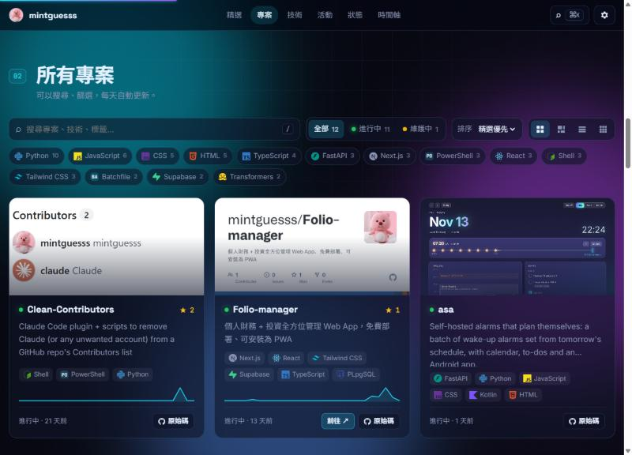

# repofolio

**Know, showcase and promote every GitHub repo you own.**

You have 20+ repos. Which ones are live? Where is each one deployed? Which Vercel URL is the real one? Where do the env vars live? What was `asa` again? repofolio scans all your repos every night and answers that in one place, then turns the public part into a portfolio site and a profile README section.

[繁體中文說明](README.zh-TW.md)

<p align="center"> </p>
<p align="center"> </p>
<p align="center"></p>

## What you get

| Output | Who sees it | What's in it |
|---|---|---|
| `CATALOG.md` | You (private hub repo) | Every repo: summary, status, stack, **deployments + live check**, services, domains, env var names and where they're stored, cost, next steps, health issues |
| `site/index.html` | Everyone | An animated, themeable portfolio of your public projects. Deploy it to GitHub Pages or commit it into your existing site |
| `site/card.svg` | Everyone | Animated neon stats card for your profile README |
| `site/projects.json` | Everyone | The same public data as JSON, for your own site to render |
| `profile.md` | Everyone | Featured-projects block, spliced into your profile README between markers |
| Stale-project issues | You | "No pushes for 119 days: keep going, mark done, or archive?" |

## Features

- **Repo inventory**: all repos you own, plus orgs and extra repos you list. Detects the stack from `package.json`, `requirements.txt` and `pyproject.toml`
- **Deployment discovery, with nothing to configure**:
  - Reads the GitHub Deployments API (Vercel, Netlify and others report there), GitHub Pages, the repo's Website field, config files (`vercel.json`, `fly.toml`, `wrangler.toml`, `Dockerfile`…) and deploy steps in workflows
  - **Ignores per-deploy URLs** like `app-3k2j9x8h1-team.vercel.app` when a stable alias exists
- **Live-URL check**: every deployment URL is pinged. Dead ones show up as errors
- **Health check**: missing README, description, topics or LICENSE; deployed but no Website field; expiring domains; **secrets accidentally pasted into metadata**
- **Stale detection**: no pushes for N days and not marked done or paused → flagged, and optionally an issue is opened
- **Optional AI summaries**: one-line summaries of each README with Claude. Results are cached by README hash, so nightly runs only pay for READMEs that changed
- **Privacy by design**: private repos and private fields (env, services, domains, cost) never reach the public site. If your hub repo is public, they're stripped from the catalog too
- English and 繁體中文 output

## The showcase site

One self-contained `index.html` (no build step, no framework, works on GitHub Pages) generated from your repos. It has two styles you (and visitors) can switch between:

- **Simple** (default): clean typography, black/white with one accent, project cover images, light/dark following the system, no effects. Looks like a well-made personal site.
- **Tech**: 10 neon presets, canvas backgrounds (particles, synthwave grid, matrix rain, starfield, circuit, aurora), glow, 3D tilt, cursor light, a typing hero and a terminal that "types out" the scan.

Pages:

- **Home**: who you are, recently updated projects, featured work, and quick links
- **Projects**: search, status filters, a collapsible tech filter, sorting and 2 layouts (grid, list). Cards show a cover image (README screenshot or social preview), status, a short summary, tech and links. Click a card for a detail view with a deep link (`#/p/name`)
- **Stats**:
  - counts: projects, live, active, stars, commits/year, languages
  - commits per week for the last year, plus the most active repos
  - language share and a tech cloud (click to filter)
  - a status donut, hosting providers and projects started per year
  - a live status board for every public deployment
- **Timeline**: a vertical timeline grouped by year (or month); the spine fills and each project lights up as you scroll, with covers drifting in parallax

Also included: a **⌘K command palette**, keyboard shortcuts (`/` search, `T` theme, `B` background, `,` customize, `?` help) and a **live customizer (⚙)**. The customizer groups its options: style, colours and layout come first, and all tech effects sit in one "Effects" group. "Copy as config" gives you YAML to paste into `repofolio.config.yml`. The site respects `prefers-reduced-motion`, is keyboard accessible and has no horizontal scroll down to 375px.

### Customization

Everything is set in `repofolio.config.yml` under `site:`, and every option can be tried live in the ⚙ panel.

```yaml
site:
  title: ""                # defaults to your GitHub name
  tagline: ""              # defaults to your GitHub bio
  url: https://you.github.io/projects/   # canonical URL, used for og:url and the profile link
  links:
    - { label: LinkedIn, url: https://www.linkedin.com/in/you }
  hero:
    roles: [Full-stack developer, ML tinkerer]   # shown as one line (simple) or typed out (tech)
    intro: ""              # overrides the GitHub bio
    terminal: true         # tech mode
    avatar: true
  sections: [hero, featured, projects, stats, status, timeline]   # order + which to show
  singlePage: false        # true = everything on one long page
  customizer: true         # show the ⚙ panel to visitors
  theme:
    mode: simple           # simple | tech
    scheme: auto           # simple mode: auto | light | dark
    accent: "#2563eb"      # optional
    bgColor: "#fafafa"     # optional page background; text colour adapts
    layout: grid           # grid | list
    font: sans             # sans | mono | display | system
    radius: 16             # 0–32 px
    # ── tech mode only ──
    preset: cyber          # cyber | midnight | matrix | synthwave | ocean | ember | aurora | mono | paper | daylight
    background: particles  # particles | grid | matrix | aurora | stars | circuit | none
    cardStyle: glass       # glass | solid | neon | outline | terminal
    animation: full        # full | subtle | off
    glow: soft             # none | soft | strong
    covers: true           # README screenshot / social preview as card cover
    cursorGlow: true
    tilt: true
    webFonts: true         # Inter, JetBrains Mono, Space Grotesk, Noto Sans TC from Google Fonts
```

Cover images are picked automatically: the first screenshot in the README, then a screenshot found in the repo (`docs/`, `screenshots/`, `.github/`…), then GitHub's social preview. To choose one yourself, set `images:` in the config (`images: { my-repo: https://…/shot.png }`) or `image:` in the repo's `.project.yml`.

Per project, `.project.yml` can set `image:` (cover screenshot), `featured: true`, `showcase: false`, `summary`, `purpose`, `tags` and `links`.

Tweak the theme without re-scanning: `repofolio render` rebuilds every output from `out/inventory.json`.

### Put it on your existing site

Already have a GitHub Pages site? Let repofolio commit the showcase into it:

```yaml
publish:
  repo: you/you.github.io      # or you/personal_web
  path: projects               # e.g. "public/projects" for a Next.js static export
  branch: main                 # optional, defaults to the repo's default branch
```

`repofolio publish` (or the Action, automatically) commits only `index.html`, `card.svg`, `projects.json` and the `admin.html` login page, and only when they changed. Never `inventory.json`, `CATALOG.md` or the admin data. `projects.json` has the same public data as the page, so your own site can render it however it likes.

### Private admin view

The same site, for your eyes only: every repo including private ones, a health score on each card, an **Admin** page listing what to fix (worst first), and env-var locations / next steps / cost in each project's details.

- `out/admin.html` is the full admin build. The hub workflow commits it to your **private** hub repo.
- The public site gets `admin.html`, a login page with no data in it (there's a small 🔒 in the footer). Paste a fine-grained token that can read the hub repo (Contents: Read-only, that repo only) and it loads the admin build straight from GitHub's API. Without access to the repo, GitHub returns 404 and there's nothing to see.
- Turn it off with `admin: { enabled: false }`; point it elsewhere with `admin: { repo: you/hub, path: admin.html }`.

## Try it in 10 seconds

You need Node 20+ and the GitHub CLI (`gh`) logged in.

```bash
npx repofolio scan
```

> Not on npm yet. Until it is: `git clone`, `npm install`, `npm run build`, then `node dist/cli.js scan`.

This writes `out/CATALOG.md`, `out/site/index.html` and the other files. Auth comes from `REPOFOLIO_TOKEN`, `GH_TOKEN` or `GITHUB_TOKEN`, and falls back to `gh auth token`.

## Run it nightly on your GitHub

**Step-by-step guide: [docs/SETUP.md](docs/SETUP.md)** ([繁體中文](docs/SETUP.zh-TW.md)). The short version:

1. Create a hub repo (private recommended) with `repofolio.config.yml` and [the workflow](templates/hub-workflow.yml)
2. Add a read-only fine-grained PAT as `REPOFOLIO_TOKEN`
3. Publish the site, either:
   - into your existing site repo (`publish:` + a `REPOFOLIO_PUBLISH_TOKEN` that can write only that repo), or
   - to the hub's GitHub Pages
4. Put the card in your profile README: `[](https://your-site/projects/)`

```yaml
- uses: mintguesss/repofolio@v0
  with:
    token: ${{ secrets.REPOFOLIO_TOKEN }}
    publish-token: ${{ secrets.REPOFOLIO_PUBLISH_TOKEN }}   # optional
    stale-issues: true
```

## `.project.yml`: the things GitHub can't know

Drop one in any repo (run `repofolio init` to get a pre-filled one). Every field is optional.

```yaml
status: active            # idea | active | maintenance | paused | done | archived
summary: Self-hosted alarms that plan themselves from tomorrow's calendar
tags: [productivity, android]
featured: true
links:
  demo: https://youtu.be/...
deployments:
  - name: production
    provider: vercel
    url: https://asa.example.com
    dashboard: https://vercel.com/me/asa
# ── private: never on the public site ──
services:
  - { name: Supabase, kind: database, plan: free, dashboard: https://supabase.com/dashboard/project/xxx }
domains:
  - { name: asa.example.com, registrar: Cloudflare, expires: 2027-03-01, autoRenew: true }
env:
  location: "Vercel env + 1Password › Dev"
  vars: [SUPABASE_URL, SUPABASE_ANON_KEY]   # names only, never values
cost: { monthly: 0, currency: USD, notes: free tier }
next: [Add iOS widget]
related: [asa-android]
```

The full schema is in [`src/schema.ts`](src/schema.ts) and there's an example in [`examples/`](examples/).

## Commands

```
repofolio scan      [--config file] [--out dir] [--no-url-check] [--llm] [--lang en|zh-TW]
repofolio init      [dir]                 pre-filled .project.yml for a local repo
repofolio init-hub  [dir]                 config + nightly workflow for a hub repo
repofolio issues    [--dry-run]           open stale-project issues in the hub repo
repofolio render    [--lang en|zh-TW]     rebuild outputs from out/inventory.json (no API calls)
repofolio publish   [--dry-run]           commit the public site to the repo in `publish:`
repofolio profile   <README.md> [--site-url url]
```

## How it compares

| | repofolio | github-readme-stats / metrics | gitfolio / gitprofile | developerFolio-style templates | Backstage |
|---|---|---|---|---|---|
| Profile README output | ✅ animated card + block | ✅ | — | — | — |
| Portfolio site | ✅ generated | — | ✅ generated | ✅ hand-edited | — |
| Stays in sync automatically | ✅ nightly | ✅ | ✅ / partly | — | ✅ |
| Themes / live customizer | 10 presets × 7 backgrounds × 5 card styles × 2 layouts, live ⚙ panel | themes | a few themes | edit the code | — |
| README screenshots as covers | ✅ | — | — | manual | — |
| Private inventory of all repos | ✅ | — | — | — | ✅ (for companies) |
| Deployment URLs + uptime | ✅ | — | — | — | plugin |
| Env, service, domain and cost notes | ✅ | — | — | — | — |
| Setup | one workflow | one URL | fork + config | fork + edit | a platform |

## Roadmap

See [docs/ROADMAP.md](docs/ROADMAP.md). Up next: weekly "what I shipped" digest, star and traffic history, and release-to-LinkedIn post drafts with human approval.

## License

MIT
