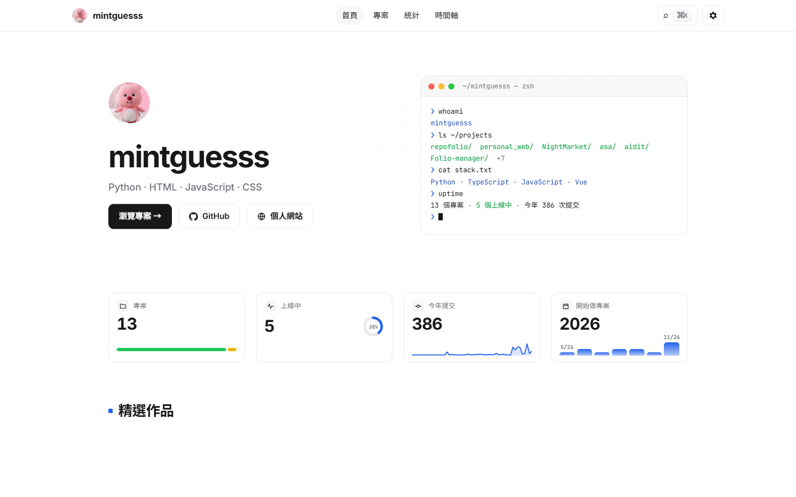
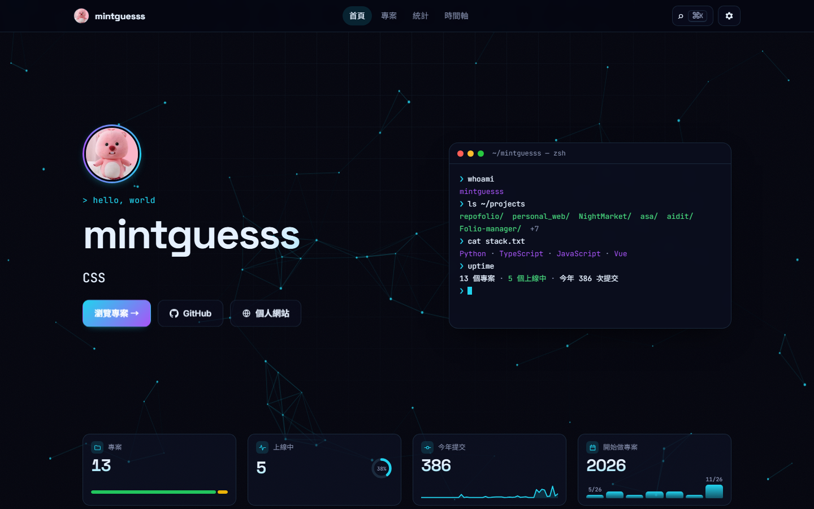
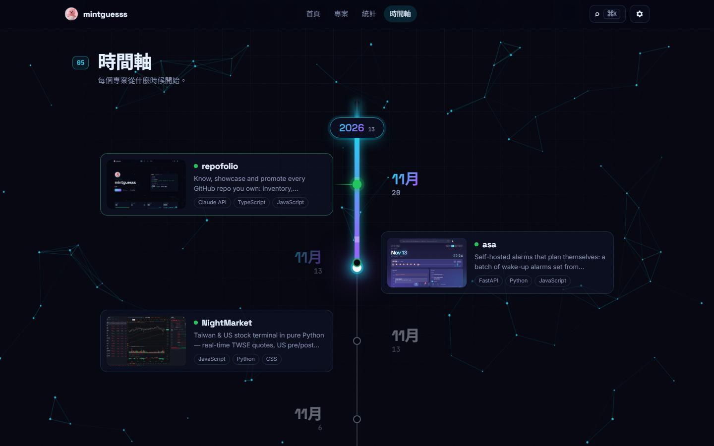
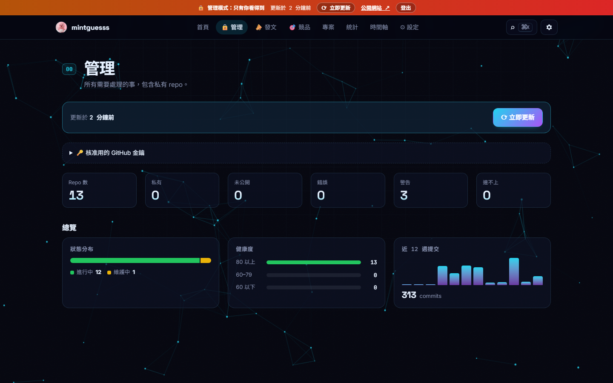
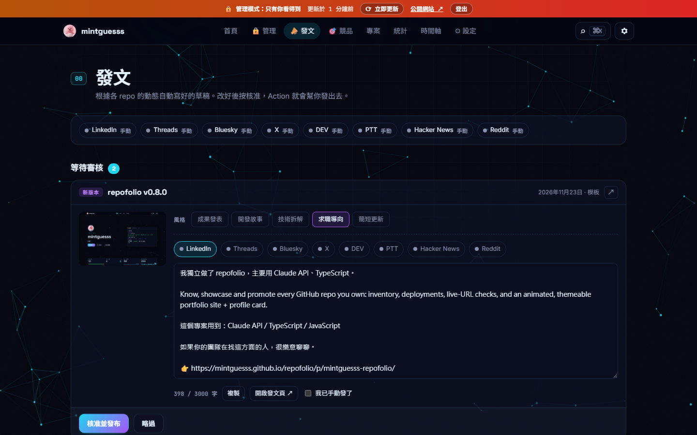
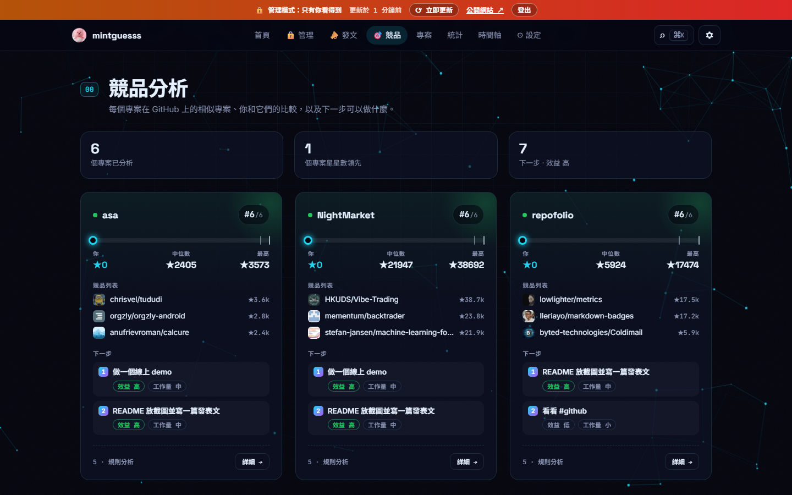
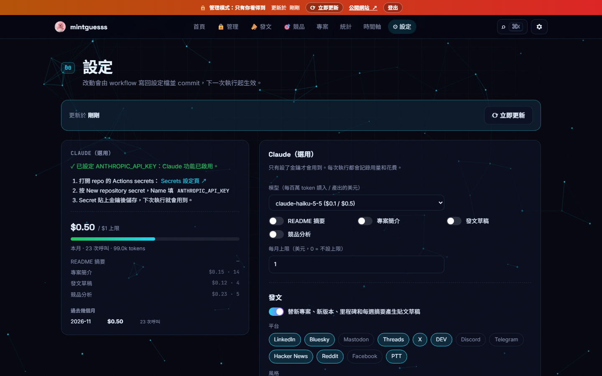

# repofolio

**Auto-promotion and project management for every GitHub repo you own.**

repofolio runs as a GitHub Action in one repo and does three jobs:

- **Promote**: new projects, releases, star milestones, sites going live and a weekly digest become post drafts for LinkedIn, Threads, Bluesky, X, DEV, Hacker News, Reddit, PTT and more. You edit and approve them in a private admin page; the Action publishes them with your own tokens.
- **Manage**: every repo in one place, private ones included: where it's deployed and whether it's up, health issues to fix, what's been idle, env-var locations, costs, and a competitor analysis per project with what to do next.
- **Showcase**: the public part becomes an animated portfolio site, a profile README card and `projects.json`, which is also where every post links to.

No server and no third-party service: state lives on a branch of your repo, encrypted when it holds private data. Claude is optional: with an `ANTHROPIC_API_KEY` it writes the intros, drafts and competitor analysis (about $1.5 a month on Sonnet 5.5, with a monthly budget cap); without it, templates and rules do the job.

[繁體中文說明](README.zh-TW.md)

<p align="center"> </p>
<p align="center"> </p>
<p align="center"> </p>
<p align="center"></p>

## What you get

| Output | Who sees it | What's in it |
|---|---|---|
| `CATALOG.md` | You (private hub repo) | Every repo: summary, status, stack, **deployments + live check**, services, domains, env var names and where they're stored, cost, next steps, health issues |
| `site/index.html` | Everyone | An animated, themeable portfolio of your public projects. Deploy it to GitHub Pages or commit it into your existing site |
| `site/card.svg` | Everyone | Animated neon stats card for your profile README |
| `site/projects.json` | Everyone | The same public data as JSON, for your own site to render |
| `profile.md` | Everyone | Featured or recently pushed projects (`profile.sort`), spliced into your profile README between `<!-- repofolio:start -->` and `<!-- repofolio:end -->` (`profile-readme` input, one file per line as `path:lang`; [example](.github/workflows/showcase.yml)) |
| Stale-project issues | You | "No pushes for 119 days: keep going, mark done, or archive?" |

## Features

- **Repo inventory**: all repos you own, plus orgs and extra repos you list. Detects the stack from `package.json`, `requirements.txt` and `pyproject.toml`
- **Deployment discovery, with nothing to configure**:
  - Reads the GitHub Deployments API (Vercel, Netlify and others report there), GitHub Pages, the repo's Website field, config files (`vercel.json`, `fly.toml`, `wrangler.toml`, `Dockerfile`…) and deploy steps in workflows
  - **Ignores per-deploy URLs** like `app-3k2j9x8h1-team.vercel.app` when a stable alias exists
- **Live-URL check**: every deployment URL is pinged. Dead ones show up as errors
- **Health check**: missing README, description, topics or LICENSE; deployed but no Website field; expiring domains; **secrets accidentally pasted into metadata**
- **Stale detection**: no pushes for N days and not marked done or paused → flagged, and optionally an issue is opened
- **Optional Claude**: project intros in two languages, post drafts and competitor analysis, with a monthly budget and usage tracking. Results are cached, so scheduled runs only pay for what changed
- **Privacy by design**: private repos and private fields (env, services, domains, cost) never reach the public site. If your hub repo is public, they're stripped from the catalog too
- English and 繁體中文 output

## The showcase site

One self-contained `index.html` (no build step, no framework, works on GitHub Pages) generated from your repos. It has two styles you (and visitors) can switch between:

- **Simple** (default): clean typography, black/white with one accent, project cover images, light/dark following the system, no effects. Looks like a well-made personal site.
- **Tech**: 10 neon presets, canvas backgrounds (particles, synthwave grid, matrix rain, starfield, circuit, aurora), glow, 3D tilt, cursor light, a typing hero and a terminal that "types out" the scan.

Pages:

- **Home**: who you are, recently updated projects, featured work, and quick links
- **Projects**: up to 6 featured projects as big cards (picked in the admin page), then the rest grouped by kind (AI / ML, web and full-stack, developer tools, other; team and course projects last) in compact cards. Each group folds; a search opens them all. Search, status filters, a collapsible tech filter, sorting and 2 layouts (grid, list). Click a card for a detail view with a deep link (`#/p/name`)
- **Stats**:
  - counts: projects, live, active, stars, commits/year, languages
  - commits per week for the last year, plus the most active repos
  - language share and a tech cloud (click to filter)
  - a status donut, hosting providers and projects started per year
  - a live status board for every public deployment
- **Timeline**: newest first, grouped by year. As you scroll, a light beam runs down the centre axis; cards slide in from alternating sides and their nodes light up as the beam passes

Also included: a **⌘K command palette**, keyboard shortcuts (`/` search, `T` theme, `B` background, `,` customize, `?` help) and a **live customizer (⚙)**. The customizer groups its options: style, colours and layout come first, and all tech effects sit in one "Effects" group. "Copy as config" gives you YAML to paste into `repofolio.config.yml`. The site respects `prefers-reduced-motion`, is keyboard accessible and has no horizontal scroll down to 375px.

### Customization

Everything is set in `repofolio.config.yml` under `site:`, and every option can be tried live in the ⚙ panel.

```yaml
site:
  title: ""                # defaults to your GitHub name
  tagline: ""              # defaults to your GitHub bio
  url: https://you.github.io/projects/   # canonical URL, used for og:url and the profile link
  links:
    - { label: LinkedIn, url: https://www.linkedin.com/in/you }
  hero:
    roles: [Full-stack developer, ML tinkerer]   # shown as one line (simple) or typed out (tech)
    intro: ""              # overrides the GitHub bio
    terminal: true         # tech mode
    avatar: true
  sections: [hero, featured, projects, stats, status, timeline]   # order + which to show
  singlePage: false        # true = everything on one long page
  customizer: true         # show the ⚙ panel to visitors
  theme:
    mode: simple           # simple | tech
    scheme: auto           # simple mode: auto | light | dark
    accent: "#2563eb"      # optional
    bgColor: "#fafafa"     # optional page background; text colour adapts
    layout: grid           # grid | list
    font: sans             # sans | mono | display | system
    radius: 16             # 0–32 px
    # ── tech mode only ──
    preset: cyber          # cyber | midnight | matrix | synthwave | ocean | ember | aurora | mono | paper | daylight
    background: particles  # particles | grid | matrix | aurora | stars | circuit | none
    animation: full        # full | subtle | off
    glow: soft             # none | soft | strong
    covers: true           # README screenshot / social preview as card cover
    cursorGlow: true
    tilt: true
    webFonts: true         # Inter, JetBrains Mono, Space Grotesk, Noto Sans TC from Google Fonts
```

Cover images are picked automatically: the first screenshot in the README, then a screenshot found in the repo (`docs/`, `screenshots/`, `.github/`…), then GitHub's social preview. To choose one yourself, set `images:` in the config (`images: { my-repo: https://…/shot.png }`) or `image:` in the repo's `.project.yml`.

Per project, `.project.yml` can set `image:` (cover screenshot), `featured: true`, `showcase: false`, `summary`, `purpose`, `tags` and `links`.

Tweak the theme without re-scanning: `repofolio render` rebuilds every output from `out/inventory.json`.

### Put it on your existing site

Already have a GitHub Pages site? Let repofolio commit the showcase into it:

```yaml
publish:
  repo: you/you.github.io      # or you/personal_web
  path: projects               # e.g. "public/projects" for a Next.js static export
  branch: main                 # optional, defaults to the repo's default branch
```

`repofolio publish` (or the Action, automatically) commits only `index.html`, `card.svg`, `projects.json` and the admin page (encrypted, or a data-free login page), and only when they changed. Never `inventory.json` or `CATALOG.md`. `projects.json` has the same public data as the page, so your own site can render it however it likes.

### Private admin view

The same site, for your eyes only: every repo including private ones and a health score on each card. There's no link to it; it lives at a file name you pick (`admin.page`). It adds:

- **🔒 Admin**: an overview (status mix, health, recent commits, idle projects, promotion and competitor summaries) and what to fix, worst first. Click an issue to act on it: fix it on GitHub (licence picker, topics, README…), ignore it, or for idle projects keep going (remind in 30 days), mark done, pause or archive. **⟳ Update now** rebuilds without waiting for the schedule; a small status at the bottom right follows the run and reloads the page when the new build is live (past the Pages cache).
- **Projects in two groups**: what's on the public site and what isn't (private or hidden repos). Press ★ on a card to feature it; order the featured list (up to 6) above the grid and save. Screenshots of private repos are fetched with your token and embedded in the encrypted page; without one you get a generated cover.
- **🚀 Live**: every site and service across your projects, private ones too: up, slow or down (down first, with the status code). Click a row to open it, see the project, jump to the repo on GitHub (to change its Website), the host's deploy settings or the Actions log, or stop the down warning. Projects without a live URL are listed too, each with a link to its repo.
- **🌐 My site** (set `personalSite`): add new things to your personal website in its own data format: projects, side projects (with a detail page), awards, certificates, experience, with photo upload (resized to 1600 px). Public repos that aren't on the site yet get a draft: with `ANTHROPIC_API_KEY`, Claude writes it after an existing entry of your site (a few per run, cached until the repo changes); otherwise rules build it from the README. Pick side project or project, edit, and press "Add to my site" to commit the entry and image to that repo with your token. Sections that would show up empty on the site are flagged before saving.
- **Project details in tabs**: overview, about (from the README), numbers, competitors and posts.
<p align="center"></p>

- **⚙ Settings**: Claude model, which features use it and the monthly budget (with this month's usage), promotion platforms and style, competitor options and language. Saving makes the workflow commit the change to your config.

Two ways to keep it private:

- **Encrypted, one repo** (recommended): set the `REPOFOLIO_ADMIN_PASSWORD` secret. The admin page is gzipped and encrypted (AES-256-GCM, key from PBKDF2-SHA256 × 600k) and published next to the public site; your browser decrypts it after you type the password, and can remember the derived key (never the password). Run repofolio inside your site repo with [`templates/site-workflow.yml`](templates/site-workflow.yml): no hub repo, one token. Use a long passphrase: the encrypted file is public, so a weak password can be guessed offline, and old versions stay in git history.
- **Private repo**: without a password, `out/admin.html` is written for a private hub repo and the public page becomes a login that loads it through the GitHub API with a read-only token.

Logs of a public repo are public, so the Action masks private repo names and never prints them. Turn the admin view off with `admin: { enabled: false }`.

### Promotion and competitor analysis

Two more admin tabs:

- **📣 Posts**: new projects, releases, star milestones, sites going live and a weekly "what I shipped" digest become drafts for LinkedIn, Bluesky, Threads, X, DEV, Mastodon, Discord, Telegram, Hacker News, Reddit, Facebook and PTT, written by Claude (with an `ANTHROPIC_API_KEY`) or from templates. Edit them, tick the platforms, hit **Approve & publish**: the workflow posts them with your own tokens. Platforms without a token get a copy button and a prefilled share link. Links go to a per-project share page with the cover as its preview card.
- **🎯 Competitors**: for each project, similar GitHub repos (spam filtered out), how you compare on stars, a feature comparison table, and next steps ranked by impact and effort.

Each draft can be rewritten in another style: launch, build story, deep dive, showcase or short update.

Private repos never appear in a post. Setup and every platform's token: [docs/PROMOTE.md](docs/PROMOTE.md).

## Try it in 10 seconds

You need Node 20+ and the GitHub CLI (`gh`) logged in.

```bash
npx repofolio scan
```

> Not on npm yet. Until it is: `git clone`, `npm install`, `npm run build`, then `node dist/cli.js scan`.

This writes `out/CATALOG.md`, `out/site/index.html` and the other files. Auth comes from `REPOFOLIO_TOKEN`, `GH_TOKEN` or `GITHUB_TOKEN`, and falls back to `gh auth token`.

## Run it nightly on your GitHub

**Step-by-step guide: [docs/SETUP.md](docs/SETUP.md)** ([繁體中文](docs/SETUP.zh-TW.md)). The short version:

1. Create a hub repo (private recommended) with `repofolio.config.yml` and [the workflow](templates/hub-workflow.yml)
2. Add a read-only fine-grained PAT as `REPOFOLIO_TOKEN`
3. Publish the site, either:
   - into your existing site repo (`publish:` + a `REPOFOLIO_PUBLISH_TOKEN` that can write only that repo), or
   - to the hub's GitHub Pages
4. Put the card in your profile README: `[](https://your-site/projects/)`

```yaml
- uses: mintguesss/repofolio@v0
  with:
    token: ${{ secrets.REPOFOLIO_TOKEN }}
    publish-token: ${{ secrets.REPOFOLIO_PUBLISH_TOKEN }}   # optional
    stale-issues: true
```

## `.project.yml`: the things GitHub can't know

Drop one in any repo (run `repofolio init` to get a pre-filled one). Every field is optional.

```yaml
status: active            # idea | active | maintenance | paused | done | archived
summary: Self-hosted alarms that plan themselves from tomorrow's calendar
tags: [productivity, android]
featured: true
links:
  demo: https://youtu.be/...
deployments:
  - name: production
    provider: vercel
    url: https://asa.example.com
    dashboard: https://vercel.com/me/asa
# ── private: never on the public site ──
services:
  - { name: Supabase, kind: database, plan: free, dashboard: https://supabase.com/dashboard/project/xxx }
domains:
  - { name: asa.example.com, registrar: Cloudflare, expires: 2027-03-01, autoRenew: true }
env:
  location: "Vercel env + 1Password › Dev"
  vars: [SUPABASE_URL, SUPABASE_ANON_KEY]   # names only, never values
cost: { monthly: 0, currency: USD, notes: free tier }
next: [Add iOS widget]
related: [asa-android]
```

The full schema is in [`src/schema.ts`](src/schema.ts) and there's an example in [`examples/`](examples/).

## Commands

```
repofolio scan      [--config file] [--out dir] [--no-url-check] [--llm] [--lang en|zh-TW]
repofolio init      [dir]                 pre-filled .project.yml for a local repo
repofolio init-hub  [dir]                 config + nightly workflow for a hub repo
repofolio issues    [--dry-run]           open stale-project issues in the hub repo
repofolio render    [--lang en|zh-TW]     rebuild outputs from out/inventory.json (no API calls)
repofolio publish   [--dry-run]           commit the public site to the repo in `publish:`
repofolio profile   <README.md> [--site-url url]
```

## How it compares

| | repofolio | github-readme-stats / metrics | gitfolio / gitprofile | developerFolio-style templates | Backstage |
|---|---|---|---|---|---|
| Profile README output | ✅ animated card + block | ✅ | — | — | — |
| Portfolio site | ✅ generated | — | ✅ generated | ✅ hand-edited | — |
| Stays in sync automatically | ✅ nightly | ✅ | ✅ / partly | — | ✅ |
| Themes / live customizer | 10 presets × 7 backgrounds × 2 layouts, live ⚙ panel | themes | a few themes | edit the code | — |
| README screenshots as covers | ✅ | — | — | manual | — |
| Private inventory of all repos | ✅ | — | — | — | ✅ (for companies) |
| Deployment URLs + uptime | ✅ | — | — | — | plugin |
| Env, service, domain and cost notes | ✅ | — | — | — | — |
| Post drafts + approval for 12 platforms | ✅ | — | — | — | — |
| Competitor analysis per project | ✅ | — | — | — | — |
| Setup | one workflow | one URL | fork + config | fork + edit | a platform |

## Roadmap

See [docs/ROADMAP.md](docs/ROADMAP.md). Up next: star and traffic history, and how each post moved them.

## License

MIT
