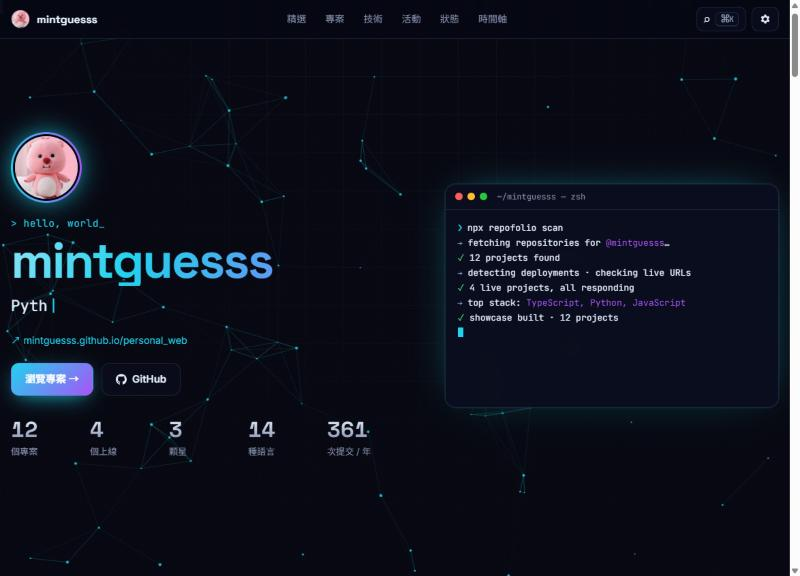
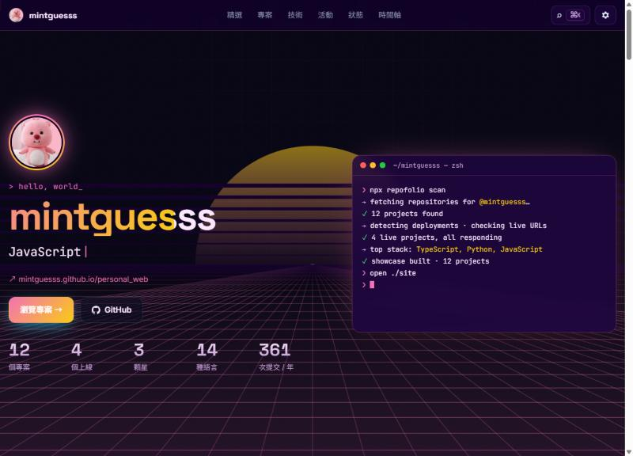
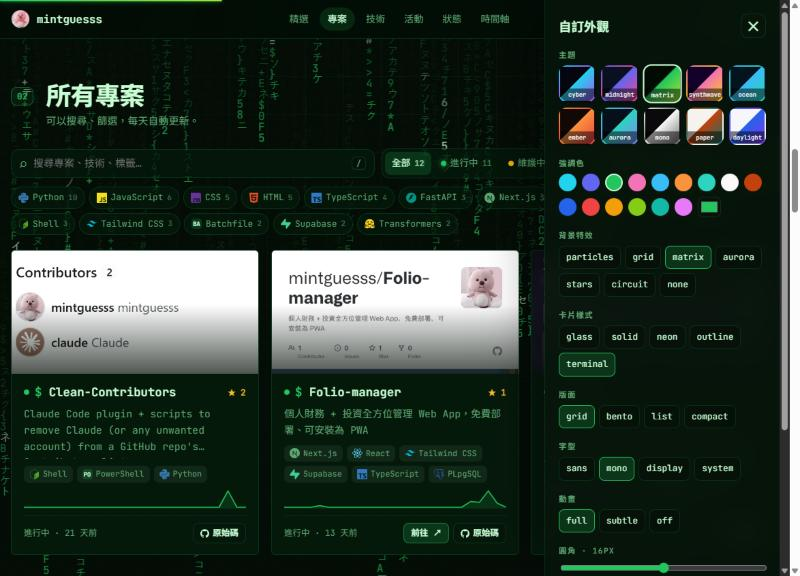

# repofolio

**Know, showcase and promote every GitHub repo you own.**

You have 20+ repos. Which ones are live? Where is each one deployed? Which Vercel URL is the real one? Where do the env vars live? What was `asa` again? repofolio scans all your repos every night and answers that in one place, then turns the public part into a portfolio site and a profile README section.

[繁體中文說明](README.zh-TW.md)

<p align="center"> </p>
<p align="center"> </p>
<p align="center"></p>

## What you get

| Output | Who sees it | What's in it |
|---|---|---|
| `CATALOG.md` | You (private hub repo) | Every repo: summary, status, stack, **deployments + live check**, services, domains, env var names and where they're stored, cost, next steps, health issues |
| `site/index.html` | Everyone | An animated, themeable portfolio of your public projects. Deploy it to GitHub Pages or commit it into your existing site |
| `site/card.svg` | Everyone | Animated neon stats card for your profile README |
| `site/projects.json` | Everyone | The same public data as JSON, for your own site to render |
| `profile.md` | Everyone | Featured-projects block, spliced into your profile README between markers |
| Stale-project issues | You | "No pushes for 119 days: keep going, mark done, or archive?" |

## Features

- **Repo inventory**: all repos you own, plus orgs and extra repos you list. Detects the stack from `package.json`, `requirements.txt` and `pyproject.toml`
- **Deployment discovery, with nothing to configure**:
  - Reads the GitHub Deployments API (Vercel, Netlify and others report there), GitHub Pages, the repo's Website field, config files (`vercel.json`, `fly.toml`, `wrangler.toml`, `Dockerfile`…) and deploy steps in workflows
  - **Ignores per-deploy URLs** like `app-3k2j9x8h1-team.vercel.app` when a stable alias exists
- **Live-URL check**: every deployment URL is pinged. Dead ones show up as errors
- **Health check**: missing README, description, topics or LICENSE; deployed but no Website field; expiring domains; **secrets accidentally pasted into metadata**
- **Stale detection**: no pushes for N days and not marked done or paused → flagged, and optionally an issue is opened
- **Optional AI summaries**: one-line summaries of each README with Claude. Results are cached by README hash, so nightly runs only pay for READMEs that changed
- **Privacy by design**: private repos and private fields (env, services, domains, cost) never reach the public site. If your hub repo is public, they're stripped from the catalog too
- English and 繁體中文 output

## The showcase site

One self-contained `index.html` (no build step, no framework, works on GitHub Pages) generated from your repos:

- **Hero**: your avatar in a spinning neon ring, a typing animation of your roles, animated counters (projects, live, stars, languages, commits/year) and a terminal that "types out" the scan
- **Featured / all projects**: cards with the README's first screenshot (or GitHub's social preview) as a cover, 3D tilt, a glow border that follows the cursor, live-status pulse, tech icons and a 26-week commit sparkline
- **Search, filters and sorting**: full-text search, status filters, tech chips (multi-select), sort by featured/stars/updated/newest/name, 4 layouts (grid, bento, list, compact) with View Transitions
- **Project detail modal** with deep links (`#p/name`): cover, language bar, deployments with response time, 52-week activity, all links
- **Tech stack**: animated language bars and an icon cloud (click a tech to filter projects)
- **Activity**: commits per week across all projects for the last year, busiest week, top repos
- **Live status board**: every public deployment, up/down, latency
- **Timeline** of when each project started
- **⌘K command palette**, keyboard shortcuts (`/` search, `T` theme, `B` background, `,` customize, `?` help) and a hidden Konami code
- **Live customizer (⚙)**: visitors can play with the theme; you can click "Copy as config" and paste the result into `repofolio.config.yml`
- Respects `prefers-reduced-motion`, keyboard accessible, no horizontal scroll down to 375px

### Customization

Everything is set in `repofolio.config.yml` under `site:`. All options can also be tried live in the ⚙ panel.

```yaml
site:
  title: ""                # defaults to your GitHub name
  tagline: ""              # defaults to your GitHub bio
  url: https://you.github.io/projects/   # canonical URL, used for og:url and the profile link
  links:
    - { label: LinkedIn, url: https://www.linkedin.com/in/you }
  hero:
    roles: [Full-stack developer, ML tinkerer, Open-source enjoyer]   # typing animation
    intro: ""              # overrides the GitHub bio
    terminal: true
    avatar: true
  sections: [hero, featured, projects, stack, activity, status, timeline]   # order + which to show
  customizer: true         # show the ⚙ panel to visitors
  theme:
    preset: cyber          # cyber | midnight | matrix | synthwave | ocean | ember | aurora | mono | paper | daylight
    accent: "#22d3ee"      # optional, overrides the preset's accent
    background: particles  # particles | grid | matrix | aurora | stars | circuit | none
    cardStyle: glass       # glass | solid | neon | outline | terminal
    layout: grid           # grid | bento | list | compact
    font: sans             # sans | mono | display | system
    animation: full        # full | subtle | off
    radius: 16             # 0–32 px
    covers: true           # README screenshot / social preview as card cover
    cursorGlow: true
    tilt: true
    webFonts: true         # Inter, JetBrains Mono, Space Grotesk, Noto Sans TC from Google Fonts
```

Per project, `.project.yml` can set `image:` (cover screenshot), `featured: true`, `showcase: false`, `summary`, `purpose`, `tags` and `links`.

Tweak the theme without re-scanning: `repofolio render` rebuilds every output from `out/inventory.json`.

### Put it on your existing site

Already have a GitHub Pages site? Let repofolio commit the showcase into it:

```yaml
publish:
  repo: you/you.github.io      # or you/personal_web
  path: projects               # e.g. "public/projects" for a Next.js static export
  branch: main                 # optional, defaults to the repo's default branch
```

`repofolio publish` (or the Action, automatically) commits only `index.html`, `card.svg` and `projects.json`, and only when they changed. Never `inventory.json` or `CATALOG.md`. `projects.json` has the same public data as the page, so your own site can render it however it likes.

## Try it in 10 seconds

You need Node 20+ and the GitHub CLI (`gh`) logged in.

```bash
npx repofolio scan
```

> Not on npm yet. Until it is: `git clone`, `npm install`, `npm run build`, then `node dist/cli.js scan`.

This writes `out/CATALOG.md`, `out/site/index.html` and the other files. Auth comes from `REPOFOLIO_TOKEN`, `GH_TOKEN` or `GITHUB_TOKEN`, and falls back to `gh auth token`.

## Run it nightly (GitHub Action)

1. Create a **private** repo to be your hub, for example `you/projects`
2. Inside it, run:

   ```bash
   npx repofolio init-hub
   ```

   This writes `repofolio.config.yml` and `.github/workflows/repofolio.yml`
3. Create a [fine-grained PAT](https://github.com/settings/personal-access-tokens/new):
   - Repository access: **All repositories**
   - Permissions (all read-only): Contents, Metadata, Deployments, Pages
   - Save it as the hub repo's `REPOFOLIO_TOKEN` secret
4. Settings → Pages → Source: **GitHub Actions**

```yaml
- uses: mintguesss/repofolio@v0
  with:
    token: ${{ secrets.REPOFOLIO_TOKEN }}
    stale-issues: true
    profile-readme: README.md   # optional
```

## `.project.yml`: the things GitHub can't know

Drop one in any repo (run `repofolio init` to get a pre-filled one). Every field is optional.

```yaml
status: active            # idea | active | maintenance | paused | done | archived
summary: Self-hosted alarms that plan themselves from tomorrow's calendar
tags: [productivity, android]
featured: true
links:
  demo: https://youtu.be/...
deployments:
  - name: production
    provider: vercel
    url: https://asa.example.com
    dashboard: https://vercel.com/me/asa
# ── private: never on the public site ──
services:
  - { name: Supabase, kind: database, plan: free, dashboard: https://supabase.com/dashboard/project/xxx }
domains:
  - { name: asa.example.com, registrar: Cloudflare, expires: 2027-03-01, autoRenew: true }
env:
  location: "Vercel env + 1Password › Dev"
  vars: [SUPABASE_URL, SUPABASE_ANON_KEY]   # names only, never values
cost: { monthly: 0, currency: USD, notes: free tier }
next: [Add iOS widget]
related: [asa-android]
```

The full schema is in [`src/schema.ts`](src/schema.ts) and there's an example in [`examples/`](examples/).

## Commands

```
repofolio scan      [--config file] [--out dir] [--no-url-check] [--llm] [--lang en|zh-TW]
repofolio init      [dir]                 pre-filled .project.yml for a local repo
repofolio init-hub  [dir]                 config + nightly workflow for a hub repo
repofolio issues    [--dry-run]           open stale-project issues in the hub repo
repofolio render    [--lang en|zh-TW]     rebuild outputs from out/inventory.json (no API calls)
repofolio publish   [--dry-run]           commit the public site to the repo in `publish:`
repofolio profile   <README.md> [--site-url url]
```

## How it compares

| | repofolio | github-readme-stats / metrics | gitfolio / gitprofile | developerFolio-style templates | Backstage |
|---|---|---|---|---|---|
| Profile README output | ✅ animated card + block | ✅ | — | — | — |
| Portfolio site | ✅ generated | — | ✅ generated | ✅ hand-edited | — |
| Stays in sync automatically | ✅ nightly | ✅ | ✅ / partly | — | ✅ |
| Themes / live customizer | 10 presets × 7 backgrounds × 5 card styles × 4 layouts, live ⚙ panel | themes | a few themes | edit the code | — |
| README screenshots as covers | ✅ | — | — | manual | — |
| Private inventory of all repos | ✅ | — | — | — | ✅ (for companies) |
| Deployment URLs + uptime | ✅ | — | — | — | plugin |
| Env, service, domain and cost notes | ✅ | — | — | — | — |
| Setup | one workflow | one URL | fork + config | fork + edit | a platform |

## Roadmap

See [docs/ROADMAP.md](docs/ROADMAP.md). Up next: weekly "what I shipped" digest, star and traffic history, and release-to-LinkedIn post drafts with human approval.

## License

MIT
