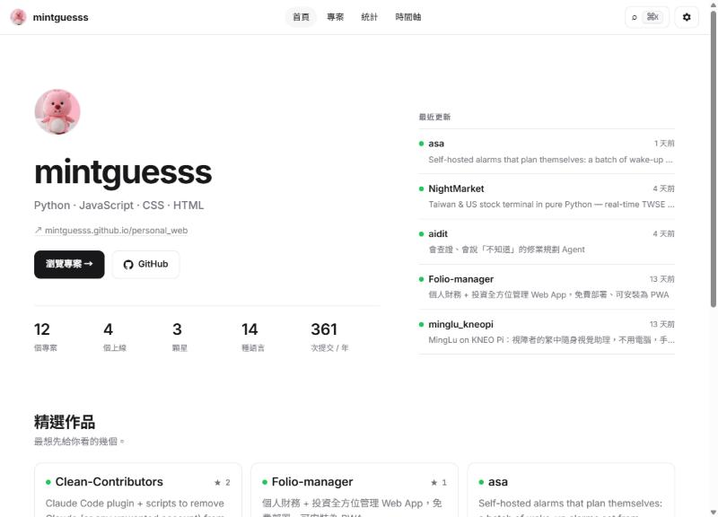

# repofolio

**把你所有的 GitHub 專案整理好、展示出來、推廣出去。**

專案一多就會忘記：哪些還在線上？每個部署在哪？一堆 Vercel 網址哪個才是正式的？環境變數放在哪？`asa` 到底是做什麼的？repofolio 每天晚上掃描你所有的倉庫，把這些整理在同一個地方，再把能公開的部分變成有科技感的作品集網站和個人頁卡片。

[English](README.md)

<p align="center"> </p>
<p align="center"> </p>
<p align="center"></p>

## 產出

| 檔案 | 給誰看 | 內容 |
|---|---|---|
| `CATALOG.md` | 你自己（放在私有的 hub repo） | 每個 repo 的摘要、狀態、技術、**部署位置與存活檢查**、外部服務、網域、環境變數名稱與存放位置、費用、下一步、健檢問題 |
| `site/index.html` | 所有人 | 有動畫、可換主題的作品集網站，只放公開專案。可以部署到 GitHub Pages，或直接推進你現有的網站 |
| `site/card.svg` | 所有人 | 個人頁用的動態霓虹統計卡片 |
| `site/projects.json` | 所有人 | 跟網站一樣的公開資料，讓你自己的網站讀取 |
| `profile.md` | 所有人 | 精選專案清單，自動寫進個人頁 README 的標記區塊 |
| 沉睡提醒 issue | 你自己 | 「119 天沒更新，要繼續、標記完成，還是封存？」 |

## 作品集網站

一個獨立的 `index.html`，不需要建置、不依賴框架。有兩種風格可以切換：

- **簡潔模式**（預設）：
  - 乾淨的字體排版，黑白配色加上一個強調色
  - 每個專案都有封面圖（README 截圖或 GitHub 預覽圖）
  - 淺色或深色跟隨系統，沒有特效
  - 看起來就像一個用心做的個人網站
- **科技模式**：
  - 10 種霓虹主題
  - 背景特效：粒子、合成波地平線、數位雨、星際穿梭、電路、極光
  - 光暈、3D 傾斜、游標光暈、打字動畫和終端機

頁面：

- **首頁**：自我介紹、最近更新的專案、精選作品、前往其他頁面的入口
- **專案**：
  - 搜尋、狀態篩選、可收合的技術篩選、排序
  - 兩種版面：卡片 grid、列表 list
  - 點卡片會開詳細視窗，可以直接分享連結（`#/p/名稱`）
- **統計**：
  - 專案數、上線數、進行中、星星、年提交、語言
  - 每週提交圖、最活躍的專案
  - 語言比例和技術雲
  - 專案狀態圓餅圖、部署平台、每年新開專案
  - 上線狀態看板
- **時間軸**：垂直時間軸，依年份（只有一年時依月份）分組，往下捲時主軸會發光填滿、每個專案依序點亮，封面帶視差

其他功能：

- ⌘K 指令面板和鍵盤快捷鍵
- ⚙ 即時自訂面板：
  - 上方先選風格、配色、版面
  - 科技模式的特效全部收在一個「特效」群組裡
  - 調好後按「複製成設定檔」，貼進設定檔就好

### 客製化選項

| 項目 | 選項 |
|---|---|
| 風格 `mode` | simple（簡潔）、tech（科技） |
| 淺色或深色 `scheme`（簡潔模式） | auto、light、dark |
| 版面 `layout` | grid、list |
| 字型 `font` | sans、mono、display、system |
| 封面圖 `images` | 預設自動抓 README 截圖、repo 裡的截圖，再來是 GitHub 預覽圖；也可以在設定檔用 `images: { repo名稱: 圖片網址 }` 指定 |
| 其他 | 強調色 `accent`、背景顏色 `bgColor`（文字顏色會自動調整）、圓角、區塊順序與顯示、身分文字、頭像 |
| 科技模式的特效 | 主題 `preset`（10 種）、背景特效 `background`（7 種）、卡片樣式 `cardStyle`（5 種）、動畫 `animation`、光暈強度 `glow`、封面圖片、游標光暈、3D 傾斜、終端機 |

完整寫法請看[英文 README 的 Customization](README.md#customization)。只想調整外觀時，執行 `repofolio render`，會直接用 `out/inventory.json` 重新產生，不用重新掃描。

### 放進你現有的網站

```yaml
publish:
  repo: you/personal_web
  path: public/projects   # Next.js 靜態輸出的話放 public/ 底下
```

執行 `repofolio publish`，或讓 Action 自動處理：

- 只會提交 `index.html`、`card.svg`、`projects.json`
- 檔案沒變就不會產生 commit
- **永遠不會**推送 `inventory.json` 或 `CATALOG.md`

## 盤點功能

- **倉庫盤點**：你的所有 repo，加上指定的組織或額外 repo。從 `package.json`、`requirements.txt`、`pyproject.toml` 偵測技術
- **自動找出部署位置，完全不用設定**：
  - 來源包括 GitHub Deployments API、GitHub Pages、repo 的 Website 欄位、設定檔和 workflow 裡的部署步驟
  - 有正式網址時，自動排除每次部署產生的一次性網址
- **網址存活檢查**、**健檢**（缺 README、description、topics、LICENSE、網域快到期、密鑰誤貼）、**沉睡偵測**
- **AI 摘要（選用）**：用 Claude 幫每個 README 寫一句話摘要，依 README 的 hash 快取
- **隱私優先**：私有 repo 和私密欄位永遠不會出現在公開網站、卡片和 `projects.json`

## 十秒試用

需要 Node 20 以上，並且已經用 `gh` 登入 GitHub：

```bash
npx repofolio scan --lang zh-TW
```

> 還沒發佈到 npm。在那之前請先 `git clone`、`npm install`、`npm run build`，再執行 `node dist/cli.js scan`。

## 在你自己的 GitHub 上設定

**一步一步的教學：[docs/SETUP.zh-TW.md](docs/SETUP.zh-TW.md)**。內容包括建立 hub repo、兩個 token 怎麼設、網站要放哪裡、怎麼放到個人頁，以及常見問題。

`.project.yml` 的寫法、完整指令和比較表請看[英文版 README](README.md)。
