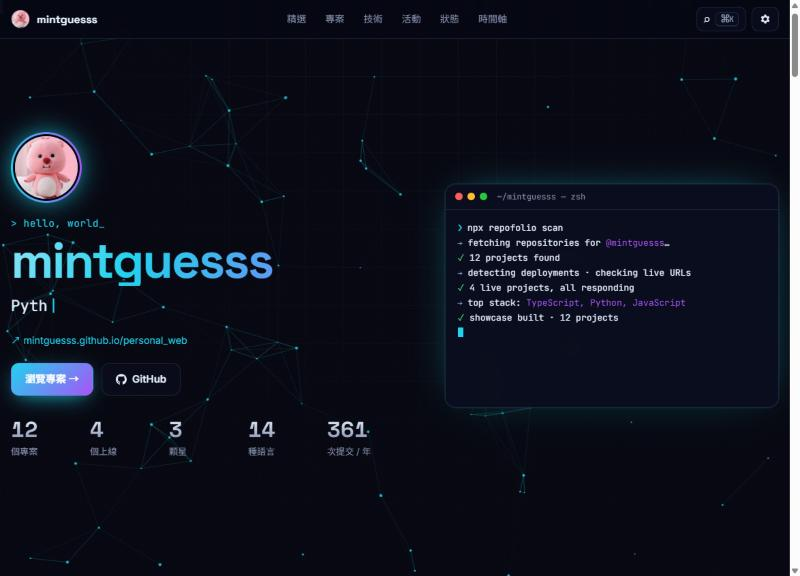
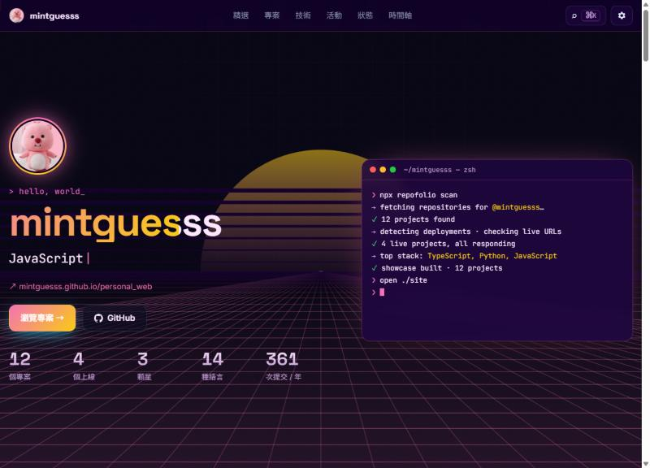
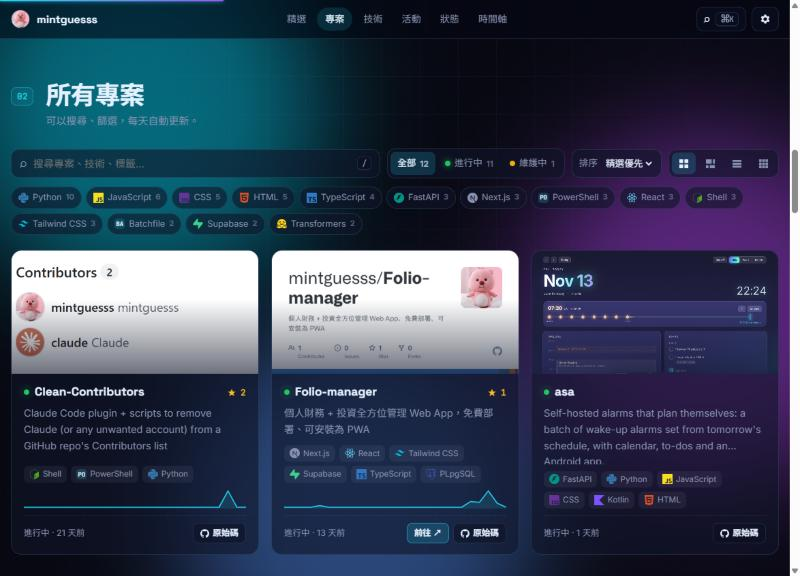

# repofolio

**把你所有的 GitHub 專案整理好、展示出來、推廣出去。**

專案一多就會忘記：哪些還在線上？每個部署在哪？一堆 Vercel 網址哪個才是正式的？環境變數放在哪？`asa` 到底是做什麼的？repofolio 每天晚上掃描你所有的倉庫，把這些整理在同一個地方，再把能公開的部分變成有科技感的作品集網站和個人頁卡片。

[English](README.md)

<p align="center"> </p>
<p align="center"> </p>
<p align="center"></p>

## 產出

| 檔案 | 給誰看 | 內容 |
|---|---|---|
| `CATALOG.md` | 你自己（放在私有的 hub repo） | 每個 repo 的摘要、狀態、技術、**部署位置與存活檢查**、外部服務、網域、環境變數名稱與存放位置、費用、下一步、健檢問題 |
| `site/index.html` | 所有人 | 有動畫、可換主題的作品集網站，只放公開專案。可以部署到 GitHub Pages，或直接推進你現有的網站 |
| `site/card.svg` | 所有人 | 個人頁用的動態霓虹統計卡片 |
| `site/projects.json` | 所有人 | 跟網站一樣的公開資料，讓你自己的網站讀取 |
| `profile.md` | 所有人 | 精選專案清單，自動寫進個人頁 README 的標記區塊 |
| 沉睡提醒 issue | 你自己 | 「119 天沒更新，要繼續、標記完成，還是封存？」 |

## 作品集網站

一個獨立的 `index.html`，不需要建置、不依賴框架：

- **首頁**：頭像外圈有旋轉的霓虹光環，打字動畫輪播你的身分，數字會跑動（專案數、上線數、星星、語言、年提交數），旁邊有一個終端機視窗模擬掃描過程
- **專案卡片**：
  - 封面自動抓 README 的第一張截圖，沒有截圖就用 GitHub 社群預覽圖
  - 滑鼠移上去有 3D 傾斜和跟著游標的光框
  - 上線狀態會脈動，並顯示技術圖示和 26 週的提交折線
- **搜尋、篩選、排序**：
  - 全文搜尋、依狀態篩選、技術標籤可以多選
  - 可依精選、星星、最近更新、最新建立、名稱排序
  - 4 種版面：grid、bento、list、compact
- **專案詳細視窗**：可以直接分享連結（`#p/名稱`），內容有語言比例、部署和回應時間、52 週活動、所有連結
- **技術棧**：語言比例長條和技術圖示雲，點一下就能篩選
- **開發活動**：過去一年每週的提交量、最忙的一週、最活躍的專案
- **上線狀態看板**：每個公開部署是否正常，以及延遲
- **時間軸**：每個專案從什麼時候開始
- **⌘K 指令面板**和鍵盤快捷鍵：`/` 搜尋、`T` 換主題、`B` 換背景、`,` 自訂、`?` 說明
- **⚙ 即時自訂面板**：
  - 訪客可以自己玩主題
  - 你調好之後按「複製成設定檔」，貼進 `repofolio.config.yml` 就好
- 支援減少動態效果的系統設定，可以全程用鍵盤操作，手機 375px 寬也不會左右捲動

### 客製化選項

| 項目 | 選項 |
|---|---|
| 主題 `preset` | cyber、midnight、matrix、synthwave、ocean、ember、aurora、mono、paper、daylight |
| 背景特效 `background` | particles（粒子連線）、grid（合成波地平線）、matrix（數位雨）、aurora（極光）、stars（星際穿梭）、circuit（電路）、none |
| 卡片樣式 `cardStyle` | glass、solid、neon、outline、terminal |
| 版面 `layout` | grid、bento、list、compact |
| 字型 `font` | sans、mono、display、system |
| 動畫 `animation` | full、subtle、off |
| 其他 | 強調色、圓角、封面圖片、游標光暈、3D 傾斜、區塊順序與顯示、打字動畫內容、終端機、頭像 |

完整寫法請看[英文 README 的 Customization](README.md#customization)。只想調整外觀時，執行 `repofolio render`，會直接用 `out/inventory.json` 重新產生，不用重新掃描。

### 放進你現有的網站

```yaml
publish:
  repo: you/personal_web
  path: public/projects   # Next.js 靜態輸出的話放 public/ 底下
```

執行 `repofolio publish`，或讓 Action 自動處理：

- 只會提交 `index.html`、`card.svg`、`projects.json`
- 檔案沒變就不會產生 commit
- **永遠不會**推送 `inventory.json` 或 `CATALOG.md`

## 盤點功能

- **倉庫盤點**：你的所有 repo，加上指定的組織或額外 repo。從 `package.json`、`requirements.txt`、`pyproject.toml` 偵測技術
- **自動找出部署位置，完全不用設定**：
  - 來源包括 GitHub Deployments API、GitHub Pages、repo 的 Website 欄位、設定檔和 workflow 裡的部署步驟
  - 有正式網址時，自動排除每次部署產生的一次性網址
- **網址存活檢查**、**健檢**（缺 README、description、topics、LICENSE、網域快到期、密鑰誤貼）、**沉睡偵測**
- **AI 摘要（選用）**：用 Claude 幫每個 README 寫一句話摘要，依 README 的 hash 快取
- **隱私優先**：私有 repo 和私密欄位永遠不會出現在公開網站、卡片和 `projects.json`

## 十秒試用

需要 Node 20 以上，並且已經用 `gh` 登入 GitHub：

```bash
npx repofolio scan --lang zh-TW
```

> 還沒發佈到 npm。在那之前請先 `git clone`、`npm install`、`npm run build`，再執行 `node dist/cli.js scan`。

## 每晚自動執行

1. 建一個 hub repo，例如 `you/projects`
2. 在裡面執行：

   ```bash
   npx repofolio init-hub
   ```

3. 建立 fine-grained PAT：
   - 存取範圍選所有 repo
   - 權限唯讀：Contents、Metadata、Deployments、Pages
   - 要用 `publish` 的話，目標 repo 另外需要 Contents 寫入權限
   - 存成 hub repo 的 `REPOFOLIO_TOKEN` secret
4. 選一種方式放網站：
   - 用 `publish` 推進你現有的公開網站 repo
   - hub repo 開 Pages：私有 repo 開 Pages 需要 GitHub Pro；hub 改成公開的話，工具會自動移除私有資料

`.project.yml` 的寫法、完整指令和比較表請看[英文版 README](README.md)。
